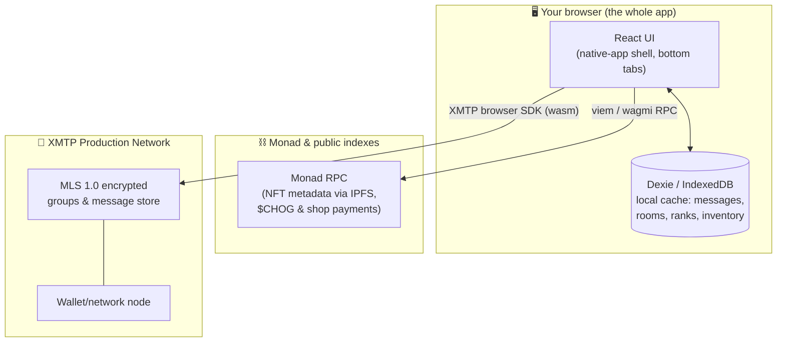
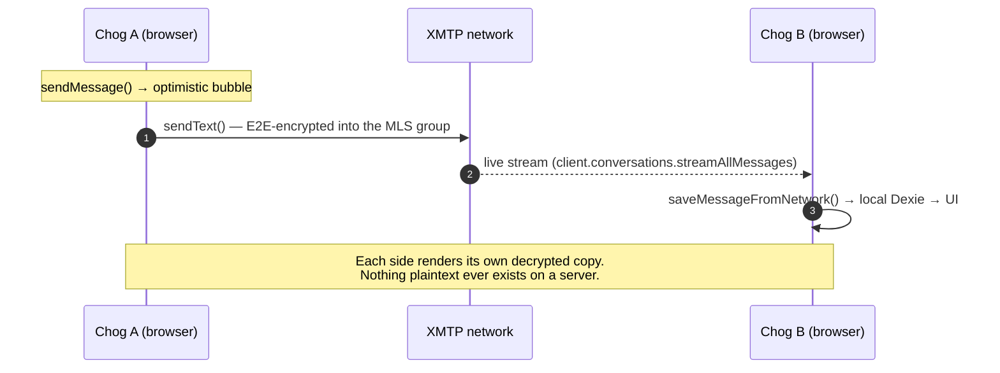
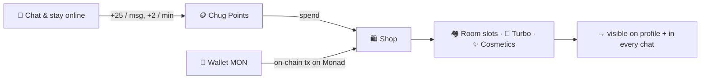

<div align="center">


# 🐸 CHUGLIFE

### **Match. Vibe. Chat. Climb.**

**The Chog-NFT-native social network on Monad — backed by XMTP end-to-end encryption.**

*Zero backend. Zero servers. Zero data to leak. Just wallets, chogs and vibes.*

[](https://chogathon.chog.xyz)
[](https://monad.xyz)
[](https://xmtp.org)
[](#-license)

</div>

---

## 💡 What is Chuglife?

**Chuglife turns a Chog NFT into a living social identity.**

Hold a Chog, sign in with your wallet, and your NFT instantly becomes:
- 💬 **Your chat identity** — your Chog avatar is your face in every message bubble
- 💘 **Your dating/compat profile** — trait-based vibe matching between chogs
- 🏘️ **Your citizenship** — create & moderate community rooms, earn a reputation
- 🛒 **Your economy** — earn **Chug Points** for being social, spend them on prestige

**Remove the NFT and none of it works.** No Chog = no identity, no matching, no rooms, no rank. The NFT isn't decoration — it *is* the account.

---

## 🧭 Jump to

| | |
|---|---|
| [Why Chog is essential](#-why-the-chog-nft-is-essential-not-decorative) | [Security & privacy](#-security--privacy--the-xmtp-model) |
| [Architecture (how it works)](#-architecture-how-it-actually-works) | [Quickstart + judge instructions](#-getting-started) |
| [The 11-rank ladder](#-the-11-rank-ladder) | [Deploying](#-deploying-to-cloudflare-pages) |
| [Rooms & Chog Police](#-️-rooms-chog-police--moderation) | [Testing](#-tests) |
| [The Shop economy](#-the-chuglife-shop-economy) | [Roadmap](#-roadmap) |

---
<!-- 
## 🏅 Built for the Chogathon judging criteria

| Criterion | Weight | How Chuglife scores |
|---|:---:|---|
| **Novelty** | 30% | An NFT is the *account, avatar, match profile AND currency holder* — social plumbing where the token can't be removed. Trait-based matching of NFTs has no comparable UX. |
| **Fun** | 20% | Vibe-matching swipes, room moderation as a playable "Chog Police" role, cosmetic prestige (neon glow, founder crown), SFX on every send/reaction/purchase. |
| **Retention** | 20% | Two compounding loops: an 11-rank ladder with visible % progress and an earn-spend economy — every message literally pays. Rooms give social lock-in. |
| **Clarity** | 15% | One-click demo mode, native-app bottom tab bar, empty states that teach, one signature for chat. |
| **Execution** | 15% | Typechecked, lint-clean production build, Playwright E2E, live on Cloudflare Pages. |
| **$CHOG bonus** | ✨ | The MON point economy and shop run entirely in Monad-native currency and off-chain Chug Points earned through Chog-centric activity. |

--- -->

## 🐸 Why the Chog NFT is essential (not decorative)

Every core mechanic reads *Chog data* (contract [`0xc96d…3763`](https://monadscan.com/token/0xc96d31f8626c6d03fae5dcd3d61e3fb9f4a73763) listed on Monad mainnet):

1. **Identity** — `PeerAvatar` resolves any wallet's first Chog & renders its IPFS image as the user's avatar across DMs, rooms, backlog and roster. No Chog → placeholder frog; identity is literally your token.
2. **Vibe Match** — the matcher loads your collection + other holders' collections and computes **trait affinity** (eyes, mouth, jersey, background…) to rank who you'll gel with. The NFT's metadata is the matching algorithm's input.
3. **Gated vibe** — room rosters and profiles surface each member's Chog, so being a holder is the price of admission to the social graph.
4. **Economy & rank** — activity converts to Chug Points/MON balances attached to the wallet that holds the NFT. Prestige items (Founder Crown, Chog Police License) are perpetual, holder-bound status.

Take the Chog out and Chuglife is an empty chat shell — **that's the point**.

---

## 🏗️ Architecture: how it actually works

**Chuglife has no backend.** Deploy the static bundle and the app runs entirely in the browser, talking to two networks:



### Message flow — two users, zero servers of ours



> 🗣️ **Plain-English version:** messages are wallet-anchored (your signature derives an XMTP *inbox*), delivered encrypted peer-to-peer-ish over XMTP, and each device keeps a local cache. Refreshing is safe — history re-syncs from the network. Different people see each other's messages because **both pull from XMTP independently**, not because either of our servers told them so.

### What lives where

| Data | Stored | Survives device switch? | Survives browser wipe? |
|---|---|:---:|:---:|
| Messages | XMTP network (encrypted) + local cache | ✅ | ✅ (re-synced) |
| Conversations / rooms (group) | XMTP groups + local | ✅ | ✅ |
| Rank, Chug Points, inventory, room slots | local (Dexie), address-keyed | ❌ (by design, see below) | ❌ |
| Moderation (police roles, bans, word filters) | local, room-scoped | ❌ | ❌ |

*Local-first is honest here: your rank is a **prestige stat**, not a balance you'd trust to a chain; every user's state is derived from the same public activity. See [Roadmap](#-roadmap) for the path to on-chain settlement.*

---

## 🔐 Security & privacy — the XMTP model

*"no backend, no database, no API keys — one wallet signature is the entire setup"*

- **End-to-end encrypted, MLS 1.0** — Chuglife ships XMTP V3, built on [MLS](https://messaginglayersecurity.rocks) (IETF-standard group messaging). Devices hold their own identity keys; the network can never read or fabricate a message.
- **Nothing to leak.** No username/password database exists anywhere. The attack surface for "hack Chuglife and dump user data" is *nil* — there is no such database.
- **Wallet-anchored identity** — 1 wallet = 1 inbox. Messages aren't "address to address" at the protocol layer; they're inbox-to-inbox inside encrypted groups, and we resolve inboxes ↔ wallet addresses for display.
- **Gasless messaging** — chatting costs nothing on-chain; the only transactions you'll ever sign are XMTP inbox registration and (optionally) a shop payment.
- **Local-first caches** — each device holds a decrypted cache (like every E2E app, WhatsApp included). Wipe it and XMTP re-syncs the same encrypted history.
- **No spam-by-default** — DM creation checks `canMessage` (recipient must have activated an inbox), and rooms put moderation in humans' hands via Chog Police.

**Honest threat-model notes** (judges appreciate this):
- The local Dexie cache holds plaintext post-decryption — inherent to any E2E messenger.
- Moderation state is per-device today; network-level enforcement is a roadmap item.
- Demo mode is a real XMTP inbox — we generate and store a throwaway key so judges can explore instantly.

---

## 🎚️ The 11-rank ladder

Rank = `chatPoints + presencePoints`, highest tier wins. Earn **25 pts per message** and **2 pts per online-minute**, ×2 under 🚀 Turbo.

```
 Legendary  ♛ ████████████████████████████████▏  34,000 pts   (5.7k msgs — the grind of gods)
   Mythic   🐉 ██████████████████████████▌          21,000
Ascendant   ☄️ █████████████████████▏              13,000
    Elite   🌌 ██████████████▍                      7,500
 Vanguard   👑 █████████▏                           4,000
Pathfinder   💎 ████▌                               2,000
Trailblazer  🔥 ██▏                                 1,000
    Hopper   ⚡ █▏                                    500
   Tadpole   🐸 █▍                                   250      (10 messages)
    Sprout   🌱 ▏                                    100      (4 messages)
  Hatchling  🥚                                          0      (you are here)
```

The **Rank Ladder modal** (tap your rank chip anywhere) shows live progress, % to next tier, message count, hours online and your full ladder position — active in chat bubbles, room roster, profile, everywhere.

---

## 🏘️ Rooms, Chog Police & moderation

| Capability | Detail |
|---|---|
| 🏘️ **Create rooms** | Your own XMTP MLS group with name, emoji & description. Everyone starts with **1 free room slot**. |
| 👥 **Live roster rail** | Desktop chat opens a right-hand rail: member **count**, every member's **Chog avatar, wallet address, rank, and role** (owner/police/YOU). |
| 👮 **Chog Police** | The owner appoints moderators. Police can enforce the word filter bypass-free and wear the teal badge in every bubble. |
| 🛑 **Word filter** | Owners/police define muted words; blocked sends show an in-chat notice. Police & owner bypass their own rules. |
| 🔨 **Bans** | Ban/unban members from the Room Dashboard; banned wallets hit a hard composer wall ("Chug police has you banned"). |
| 🗑️ **Room lifecycle** | Owners archive rooms, which clears roles/bans/filters in one sweep. |

Starter rooms every user gets on first run: **🐸 The Frog Pond**, **⚡ Monad Speed Lounge**, **🔥 Chog Dating & Traits**.

---

## 🛒 The Chuglife Shop economy

Every purchase is a choice: **pay from your wallet in native MON** (on-chain transfer on Monad, lands in your inventory the moment the tx confirms) **or spend earned Chug Points** (the social currency you farm by chatting). Both paths run through the same inventory ledger.

| Item | MON | Chug Points | Effect |
|---|---:|---:|---|
| 🏘️ Room Pack ×5 | 200 | 11,000 | Room cap 1 → 5 |
| 🏙️ Room Pack ×8 | 900 | 11,500 | Room cap → 8 |
| 🚀 Turbo Vibes (1h) | 200 | 10,300 | 2× rank & point earnings for an hour |
| 🪛 Neon Name Glow | 300 | 10,500 | Your name glows violet in every bubble |
| 🛡️ Chog Police License | 300 | 10,400 | Honorary 👮 badge across all rooms + filter bypass |
| 🌌 Cosmic Neon Theme | 500 | 10,500 | Magenta-aurora aura on your bubbles & profile |
| 🐸 Chog Reaction Pack | 300 | 10,100 | Unlocks 🚀 💎 🔥 👑 reaction set |
| 👑 Founder Crown | 1,500 | 12,500 | Perpetual crown next to your handle |

Every purchase appears **instantly in your profile inventory strip** and visibly changes your look — cosmetics are real code, not promises.



> Demo identities start with a funded **12,500-point grant** so judges can experience the full earn→spend→equip loop in one session.

---

## 📱 100x native-app UX

- **Bottom tab dock** (Chats · Explore · Match · Rooms · My Chogs · Shop) with animated active pill, spring physics and a live points badge on the Shop tab.
- **True-black cosmic theme** with drifting **Chog NFT collage backdrops** — every page gets a different deterministic arrangement of real Chog art from IPFS.
- **Game-feel audio** (WebAudio, zero asset files): bubbly send pop, soft receive ping, reaction tick, purchase arpeggio.
- Safe-area aware (notch/home-indicator), scroll-locked page chrome, 44px+ tap targets, reduced-motion support, `dvh` chat viewport.
- Desktop gets a centered 1152px app column with a persistent rooms sidebar + roster rail.

---

## 🚀 Getting started

### 👩‍⚖️ For judges — 60-second test, no wallet needed

1. Open the deployed app link.
2. Click **“Try the Chuglife demo”** → instant identity, pre-funded with 12,500 Chug Points.
3. Create a room → send messages → watch rank/points climb → buy a 🚀 Turbo + ✨ cosmetic from the Shop with points → see it on your profile.
4. To test multi-user chat: open the app in a second browser/profile, and invite that identity's address via **Room Dashboard → Add member**.

*(Demo mode uses a real XMTP identity generated in your browser — messages actually ride the production XMTP network.)*

### 💻 For developers

```bash
git clone https://github.com/Joshaw-k/MatchCast.git
cd MatchCast
npm install
npm run dev          # http://localhost:5173
```

**Two users, two machines:** each opens the app, connects a wallet OR uses demo mode, then adds each other via Room Dashboard → Add member (or starts a DM with `/new/0x…`).

### Environment variables (all optional)

| Variable | Default | Purpose |
|---|---|---|
| `VITE_XMTP_ENV` | `production` | XMTP network (`production` / `dev`) |
| `VITE_WALLET_CONNECT_PROJECT_ID` | placeholder | Your WalletConnect ID — without it, mobile-wallet QR flows fail |
| `VITE_SHOP_TREASURY` | *unset* | Monad address that receives shop MON payments (unset = MON checkout shows "offline", points checkout still works) |
| `VITE_ETHERSCAN_API_KEY` | *unset* | Unlocks live holder discovery; unset falls back to a bundled 24-chog dataset |

---

## 🕸️ Deploying to Cloudflare Pages

```bash
npm run build       # → dist/
```

- **Build command:** `npm run build` · **Output:** `dist` · **Node 20+**
- `public/_redirects` (`/* /index.html 200`) is included so all client-side routes (`/rooms`, `/c/<topic>`, …) survive a hard refresh — don't remove it.
- Set the env vars above in Pages → *Settings → Environment variables*, then **redeploy** (VITE_* vars are baked at build time).

---

## 🧱 Tech stack

| Layer | Choice | Why |
|---|---|---|
| Messaging | **XMTP V3 browser SDK** (MLS 1.0, wasm) | E2E-encrypted group chat with no backend to run |
| Wallet | **RainbowKit + wagmi + viem** | Monad mainnet + multi-wallet connect |
| Chain | **Monad (143)** & `$CHOG` [`0x3500…7777`](https://monadscan.com) | On-chain payments + NFT reads |
| State | **Dexie (IndexedDB) + live queries** | Local-first, instant UI, zero API |
| UI | React 18 + Vite 6 + Tailwind + Framer Motion | Native-feeling motion & layout |
| Icons/FX | lucide-react, WebAudio SFX | No icon bloat, no audio assets |
| Tests | **Playwright** | Real two-identity XMTP E2E flows |

---

<!-- ## ✅ Tests

```bash
npm run typecheck   # strict TS, zero errors
npm run lint        # zero warnings allowed
npm run build       # production build
npx playwright test # E2E: landing, demo identity, chat flows
``` -->

---

## 🗺️ Roadmap

| Phase | Item |
|---|---|
| **Next** | 🔗 Share-to-join room invite links · 📣 XMTP push notifications · 🏆 Weekly rank leaderboards on-chain |
| **Then** | ⛓️ On-chain rank settlement (periodic Merkle-ized activity snapshots settled in $CHOG) · Room-hosted tips in $CHOG · Cross-device moderation policy synced through the room itself |
| **Later** | 🤖 AI Chog-mate Q&A in rooms · Trait-avatar dress-up · Chog-battle mini-games in rooms |

---

## 🙌 Credits & license

Built for **Chogathon 2026** on the Chog/Chogtober IP, powered by XMTP's decentralized messaging and Monad's high-performance EVM.

Licensed MIT © 2026 Chuglife. **Take the NFT out — nothing works.** 🐸⚡
